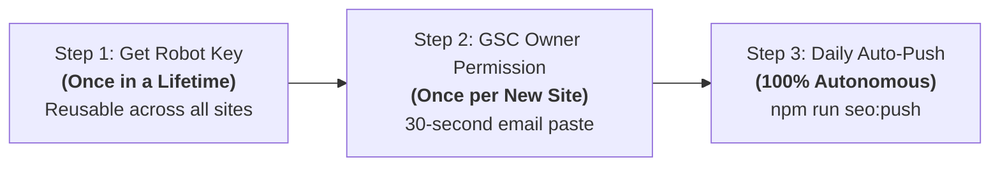

<div align="center">

# ⚡ seo-google-indexer

**Google Official Fast Indexing Push Tool & Antigravity / Claude Code Skill (Indexing API v3)**  
*Universal support for Astro, Next.js, Nuxt, Vue, Vite, static HTML, and any web project.*

[](LICENSE)
[](https://nodejs.org/)
[](https://developers.google.com/search/apis/indexing-api/v3/quickstart)

[English](README.md) • [简体中文](README.zh-CN.md) • [日本語](README.ja.md) • [Español](README.es.md)

[Features](#-key-features) • [Human Steps (Only 2)](#-human-checklist-only-2-quick-steps) • [1-Click Install](#-1-click-install-prompt-for-ai-assistants) • [Reliability & Safety](#-engineering-reliability--safety-gates) • [FAQ](#-faq)

</div>

---

## ⚡ 1-Click Install Prompt (For your AI Assistant)

If you are using **Antigravity**, **Claude Code**, or other agentic coding assistants, copy and paste this single prompt directly:

```markdown
Please install and set up this Google fast indexing push skill for me:
https://github.com/Sacilave/seo-google-indexer.git
After installation, run self-diagnosis and initialize the indexing push script in the current project.
```

---

## 📖 How It Works: Are We Submitting to GSC?

**No, this does NOT simply submit sitemaps through Google Search Console web UI. It communicates directly with Google's official `Web Search Indexing API (v3)`.**

- **Submitting sitemaps in GSC**: Acts as a passive suggestion. Crawlers may take **days or weeks** to index new updates depending on Google's backlog.
- **Calling the Indexing API (This Project)**: Dispatches real-time `URL_UPDATED` events directly to the Googlebot crawler scheduling engine, notifying it to crawl immediately. Bots typically visit within **minutes to hours**!

> 💡 **Why does Google Search Console matter then?**  
> Google requires your Google Cloud Service Account robot to be added as an **Owner** of your site in GSC to verify authorized domain ownership.

---

## ✨ Key Features

- 🚀 **Minute-Level Crawl Trigger**: Eliminate long waiting times; push directly to Googlebot core scheduling.
- 🎯 **All-Scenario Input Modes**:
  - **Local Mode**: Automatically discovers `public/sitemap.xml`, `dist/sitemap.xml`, or `build/sitemap.xml`.
  - **Nested Index Support**: Automatically detects and unfolds `<sitemapindex>` child sitemaps recursively.
  - **Remote Sitemap Mode**: No local build needed. Push directly from your live domain: `npm run seo:push https://example.com/sitemap.xml`.
  - **Single URL Instant Mode**: Push an article right after publishing: `npm run seo:push https://example.com/blog/my-post`.
- 🛡️ **Production-Grade Reliability**:
  - **150ms Smooth Rate Limiting**: Built-in micro-delays prevent concurrency rate spikes.
  - **Automatic Exponential Backoff**: Auto-retries upon transient network jitter or `429 Too Many Requests`.
  - **Daily 200 Quota Circuit Breaker**: Auto-truncates and alerts when exceeding Google's daily limit to prevent spam errors.
  - **`--dry-run` Simulation Mode**: Preview extracted URLs without consuming daily API quota.
  - **`--doctor` Self-Inspection**: Validates credentials, proxy connectivity, and displays your service account email.
- 🌐 **Zero-Dependency Native Proxy Tunnel**: Native HTTP CONNECT proxy socket, auto-probing ports (`7897`, `7890`, `10809`).
- 🔒 **Privacy & Credential Isolation**: Zero hardcoded secrets, multi-tier discovery, and automated `.gitignore` safeguards.

---

## 📋 Human Checklist (Only 2 Quick Steps)

Except for 100% automated daily pushes, humans only ever touch 2 simple steps:



### Step 1: Get Google Service Account Key (🌟 Once in a Lifetime)
Enable the Indexing API on [Google Cloud Console](https://console.cloud.google.com/) and download a Service Account JSON key.  
*(Read our 3-minute step-by-step walkthrough in [references/gsc-auth-guide.md](references/gsc-auth-guide.md))*

- **Privacy-Conscious Recommended**: Rename the downloaded file to `service-account.json` and place it in your global user folder:
  - **Windows**: `C:\Users\<YourUsername>\.config\google-seo\service-account.json`
  - **macOS / Linux**: `~/.config/google-seo/service-account.json`  
  *(All your present and future websites will automatically share this key across workspaces—no need to copy private keys into individual repos!)*

---

### Step 2: Grant Owner Access in GSC (🌟 30s per New Website)
1. Go to [Google Search Console](https://search.google.com/search-console) and select your website property.
2. Click **Settings** ➡️ **Users and permissions** ➡️ **Add user**.
3. Paste your Service Account email (Run `npm run seo:push -- --doctor` to highlight it directly).
4. **Permission must be set to "Owner"**. Click save.

---

### Step 3: Daily Routine (🤖 100% Autonomous)
Whenever you deploy or update content:
```bash
npm run seo:push
```
Or tell your AI assistant: *"Push my sitemap to Googlebot."*

---

## 🛠️ Installation & Usage

### Method 1: Global Agent Skill (Recommended)

Clone directly into your skill directory:
```bash
git clone https://github.com/Sacilave/seo-google-indexer.git ~/.gemini/config/skills/seo-google-indexer
```

Usable anywhere in your workspace via AI commands:
- `/seo-google-indexer init` - Injects scripts, configures `package.json`, and fortifies `.gitignore`.
- `/seo-google-indexer push` - Dispatches indexing notifications (supports local, live sitemaps, or single URLs).
- `/seo-google-indexer doctor` - Checks runtime environment, proxy status, and prints the robot email.
- `/seo-google-indexer gsc` - Pulls up GSC authorization guidelines and troubleshooting steps.

---

### Method 2: Standalone Project Script

1. Copy `templates/google-index.template.js` into your project as `scripts/google-index.js`.
2. Add to your `package.json`:
   ```json
   {
     "scripts": {
       "seo:push": "node scripts/google-index.js"
     }
   }
   ```
3. Run with full CLI capabilities:
   ```bash
   # Self-diagnosis & print robot email
   npm run seo:push -- --doctor

   # Dry-run rehearsal (Zero quota consumption)
   npm run seo:push -- --dry-run

   # Full automated push
   npm run seo:push

   # Push remote sitemap or single article
   npm run seo:push https://example.com/sitemap.xml
   npm run seo:push https://example.com/blog/hello-world
   ```

---

## 🛡️ Engineering Reliability & Safety Gates

1. **Credential Leak Prevention**:
   The root `.gitignore` strictly excludes:
   ```gitignore
   *service-account*.json
   *indexer*.json
   *.secret.json
   ```
2. **Quota & Rate Limits**:
   - Google Indexing API provides a default allocation of **200 URLs / day per project** (resets at UTC midnight).
   - Built-in circuit breaker auto-truncates requests past 200 items, and 150ms throttling eliminates burst triggers.

---

## ❓ FAQ

<details>
<summary><b>Q: Why do I get a 403 Permission Denied error?</b></summary>
A: In 99% of cases, the Service Account email was not granted "Owner" permission in Google Search Console (or was added with only "Full" / "Restricted" permissions). Change the role to "Owner" in GSC settings.
</details>

<details>
<summary><b>Q: What if no sitemap.xml is found?</b></summary>
A: If it's a new build, run <code>npm run build</code> first. If already published live, pass the URL directly: <code>npm run seo:push https://yoursite.com/sitemap.xml</code>.
</details>

<details>
<summary><b>Q: How do I handle local proxy connectivity issues?</b></summary>
A: The script includes native port probing for 7897, 7890, 10809. You can also specify an environment variable:
<code>export HTTPS_PROXY=http://127.0.0.1:7890</code> (macOS/Linux) or <code>set HTTPS_PROXY=http://127.0.0.1:7890</code> (Windows).
</details>

---

## 📄 License

Distributed under the [MIT License](LICENSE).
