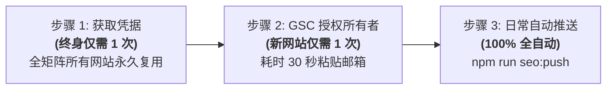

<div align="center">

# ⚡ seo-google-indexer

**Google 官方秒级收录推送工具 (Google Indexing API v3)**  
*适用于 Astro / Next.js / Nuxt / Vue / Vite / 纯 HTML 等任意前端网站*

[](LICENSE)
[](https://nodejs.org/)
[](https://developers.google.com/search/apis/indexing-api/v3/quickstart)

[English](README.md) • [简体中文](README.zh-CN.md) • [日本語](README.ja.md) • [Español](README.es.md)

[核心特性](#-核心特性) • [人工操作清单 (只需做2步)](#-人工操作清单极为简短) • [一键安装与使用](#-一键安装与使用) • [高可靠性设计](#-工程可靠性与风控设计) • [常见问题](#-常见问题-faq)

</div>

---

## ⚡ 一键安装 Prompt（直接发给你的 AI Assistant）

如果你使用的是 **Antigravity** 或 **Claude Code**，无需手动执行繁琐命令，只需将以下 Prompt 复制并发送给你的 AI 编程助手：

```markdown
请帮我安装并配置这个 Google 秒级收录推送 Skill：
https://github.com/Sacilave/seo-google-indexer.git
安装后请帮我自检环境并初始化当前项目的收录推送脚本。
```

---

## 📖 原理说明：我们是在往 GSC 提交吗？

**不是普通 GSC 提交，而是 Google 官方底层的 `Web Search Indexing API`。**

- **在 GSC 后台提交 Sitemap**：相当于递交一张“建议清单”，爬虫何时抓取完全看 Google 心情，往往需要等待**数天至数周**。
- **调用 Indexing API 实时通知（本项目）**：直接向 Google 调度系统发送 `URL_UPDATED` 实时事件，通知 Googlebot *“页面已更新，请立刻派蜘蛛来抓”*，通常在**数分钟到数小时内**就会前来抓取！

---

## ✨ 核心特性

- 🚀 **秒级/小时级爬虫唤起**：跳过漫长被动等待，主动直通 Googlebot 调度中心。
- 🎯 **全场景输入支持**：
  - **本地模式**：自动定位 `public/sitemap.xml` 或 `dist/sitemap.xml`。
  - **多地图嵌套递归**：自动展开 `<sitemapindex>` 内部的所有子地图。
  - **线上地图模式**：无需本地 build，直接推线上最新地址：`npm run seo:push https://example.com/sitemap.xml`。
  - **单页面即时模式**：发完单篇新文章，立即单推：`npm run seo:push https://example.com/blog/my-post`。
- 🛡️ **工业级可靠性保障**：
  - 内置 **150ms 请求防抖平滑延时**，避免并发过高被限流。
  - 遇到 `429 Too Many Requests` **自动指数退避重试**。
  - **单日 200 条硬配额自动熔断保护**（超出自动截断并警告，防止刷屏报错）。
  - 支持 `--dry-run` 预览演练模式（零配额消耗）。
- 🌐 **国内网络免配置适配**：自动识别 Clash / Mihomo / v2ray 本地代理端口（7897, 7890, 10809 等）。
- 🔒 **严格的隐私与安全保护**：零敏感信息硬编码，自动维护 `.gitignore`。

---

## 📋 人工操作清单（极为简短）

除日常发布完全自动外，只有以下两个步骤需要人类操作：



### 步骤 1：获取 Google 服务账号凭据（🌟 终身只需 1 次，全站通用）
在 [Google Cloud Console](https://console.cloud.google.com/) 启用 Indexing API 并下载服务账号 JSON 密钥。  
*(详细保姆级点击向导请阅读 [references/gsc-auth-guide.md](references/gsc-auth-guide.md))*

- **重隐私用户推荐**：将下载的文件重命名为 `service-account.json`，直接放入电脑用户全局目录：
  - **Windows**: `C:\Users\<你的用户名>\.config\google-seo\service-account.json`
  - **macOS/Linux**: `~/.config/google-seo/service-account.json`  
  *(后续无论开多少个新网站，脚本会自动跨项目读取，永不需要在项目里复制密钥！)*

---

### 步骤 2：在 Google Search Console 授权机器人（🌟 每个新网站只做 1 次，耗时 30 秒）
为了让 Google 确认你拥有该网站的管辖权：
1. 打开 [Google Search Console](https://search.google.com/search-console)，切换到当前网站属性。
2. 左侧点击 **「设置」 ➡️ 「用户和权限」 ➡️ 「添加用户」**。
3. 粘贴你的机器人服务账号邮箱（运行 `npm run seo:push -- --doctor` 会直接高亮打印出来）。
4. **权限务必选择「所有者 (Owner)」**，点击保存。

---

### 步骤 3：日常发布与推送（🤖 100% 全自动化）
网站发布后，运行一条命令即可：
```bash
npm run seo:push
```
或者在 Agent 中直接对它说：“帮我推送到 Google 抓取”。

---

## 🛠️ 一键安装与使用

### 方式 1：作为 Antigravity / Claude Code 全局技能安装（推荐）

直接克隆本仓库到技能目录：
```bash
git clone https://github.com/<your-username>/seo-google-indexer.git ~/.gemini/config/skills/seo-google-indexer
```

在对话中随时调用：
- `/seo-google-indexer init`：自动为当前项目注入脚本、配置 `package.json` 并加固 `.gitignore`。
- `/seo-google-indexer push`：执行推送（支持传入远程链接或单网页 URL）。
- `/seo-google-indexer doctor`：自检环境、网络代理连通性并高亮打印授权邮箱。
- `/seo-google-indexer gsc`：快速调出 30 秒授权指南与排查方案。

---

### 方式 2：作为独立项目脚本

1. 将 `templates/google-index.template.js` 复制为你项目中的 `scripts/google-index.js`。
2. 在 `package.json` 中配置：
   ```json
   {
     "scripts": {
       "seo:push": "node scripts/google-index.js"
     }
   }
   ```
3. 运行体验：
   ```bash
   # 1. 运行自检与查看授权邮箱
   npm run seo:push -- --doctor

   # 2. 演练预览（不消耗配额）
   npm run seo:push -- --dry-run

   # 3. 正式全量推送
   npm run seo:push

   # 4. 指定推线上站点地图 / 单篇新文章
   npm run seo:push https://example.com/sitemap.xml
   npm run seo:push https://example.com/blog/my-latest-post
   ```

---

## 🛡️ 工程可靠性与风控设计

1. **防凭据泄露**：
   项目 `.gitignore` 强制包含：
   ```gitignore
   *service-account*.json
   *indexer*.json
   *.secret.json
   ```
2. **配额与频控**：
   - Google Indexing API 单日项目总配额上限为 **200 条 URL**（次日 UTC 午夜自动重置）。
   - 脚本内置单日超 200 条自动安全截取与告警，并内置 150ms 平滑延时，彻底杜绝瞬间刷爆导致 429 失败。

---

## ❓ 常见问题 (FAQ)

<details>
<summary><b>Q: 出现 403 Permission Denied 是什么原因？</b></summary>
A: 这是最常见的情况，100% 是因为在 Google Search Console 中未将服务账号添加为「所有者 (Owner)」（误选成了“完整”或“受限”权限）。请进入 GSC 权限列表将其更改为「所有者」。
</details>

<details>
<summary><b>Q: 提示「未检测到有效 sitemap.xml」怎么办？</b></summary>
A: 如果是刚拉取的项目，请先运行 <code>npm run build</code> 生成构建产物；或者如果你网站已经上线，可以直接传入线上网址：<code>npm run seo:push https://yoursite.com/sitemap.xml</code>。
</details>

<details>
<summary><b>Q: 国内代理连不上 Google API 怎么办？</b></summary>
A: 脚本已内置针对 7897、7890、10809 等常见代理端口的智能环回探测；也可以手动指定环境变量：
<code>set HTTPS_PROXY=http://127.0.0.1:7890</code>（Windows）或 <code>export HTTPS_PROXY=http://127.0.0.1:7890</code>（macOS/Linux）。
</details>

---

## 📄 开源许可证

本项目基于 [MIT 许可证](LICENSE) 开源。
